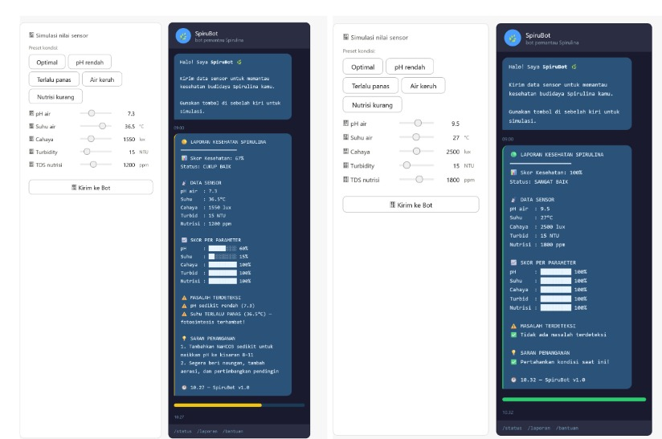

# 🌱 SPIRUTWIN — Smart IoT Spirulina Cultivation & Monitoring Dashboard

<p align="center">
  
</p>

<p align="center">
  <b>Sistem Cerdas Pemantauan Kualitas Air & Estimasi Biomassa Mikroalga Spirulina Berbasis Internet of Things (IoT)</b>
</p>

<p align="center">
  <i>Karya Inovasi Tim <b>Tech Crusaders</b> — Politeknik Negeri Sambas (KMIPN 2026)</i>
</p>

---

## 📌 Sekilas Proyek

**SPIRUTWIN** adalah platform digital twin dan pemantauan berbasis IoT yang dirancang khusus untuk budidaya mikroalga *Spirulina platensis*. Sistem ini membantu pembudidaya dan peneliti memantau kondisi fisik-kimia air kolam secara *real-time*, mencegah gagal panen, serta mengestimasi biomassa panen menggunakan algoritma prediktif.

<p align="center">
  
  <br>
  <em>Perangkat Monitoring Lapangan pada Kolam Budidaya Spirulina</em>
</p>

---

## ✨ Fitur Utama

- 📊 **Real-time Water Quality Monitoring:** Pemantauan parameter krusial air kolam (pH, suhu, dissolved oxygen, TDS, dan turbiditas).
- 🧬 **Digital Twin Kolam:** Visualisasi kondisi aktual vs simulasi kondisi optimal pertumbuhan mikroalga.
- 📈 **AI Biomass Prediction:** Estimasi laju pertumbuhan biomassa (kg/m³) dan rekomendasi jendela panen terbaik.
- 📱 **Integrasi Bot Telegram (`@Spirulinatwin_bot`):** 
  - Notifikasi instan saat kondisi kolam melewati ambang batas aman.
  - Registrasi identitas petani otomatis berbasis *Telegram User ID*.
- 👨‍🌾 **Manajemen Data Petani:** Penugasan kolam dan pemantauan aktivitas lapangan.

<p align="center">
  
  <br>
  <em>Layanan Notifikasi dan Laporan Kondisi Kolam via Telegram Bot</em>
</p>

---

## 🛠️ Arsitektur Teknologi

- **Frontend:** HTML5, CSS3 Modern (Custom Responsive Layout), JavaScript (Vanilla JS dengan State Management ringan).
- **Backend Service:** Laravel 10 (PHP Framework) untuk REST API, sinkronisasi data sensor, dan manajemen webhook.
- **Hardware & IoT:** Sensor probe industri (pH, Temp, DO, TDS) terhubung dengan mikrokontroler berkoneksi internet.
- **Notifikasi:** Telegram Bot API via Webhook.

---

## 🚀 Panduan Membuka & Menjalankan Dashboard

### 1. Menjalankan Frontend (Cepat & Mandiri)
Kamu dapat langsung membuka dashboard antarmuka tanpa perlu server lokal:
1. Clone repositori ini:
   ```bash
   git clone https://github.com/0dexvnn/spirutwin-iot-dashboard.git
   ```
2. Buka file `index.html` langsung menggunakan browser modern (Google Chrome, Mozilla Firefox, atau Microsoft Edge).

### 2. Menjalankan Backend API (Opsional untuk Pengembangan)
Jika ingin menjalankan server backend Laravel:
1. Masuk ke folder backend:
   ```bash
   cd backend
   ```
2. Salin template environment:
   ```bash
   cp .env.example .env
   ```
3. Konfigurasi kredensial database dan Token Bot Telegram Anda pada file `.env`:
   ```env
   TELEGRAM_BOT_TOKEN=your_bot_token_here
   ```
4. Pasang dependensi dan jalankan migrasi:
   ```bash
   composer install
   php artisan key:generate
   php artisan migrate
   php artisan serve
   ```

---

## 👥 Tim Pengembang (Tech Crusaders)

- **Ketua & Pengembang Utama:** 0dexvnn ([@0dexvnn](https://github.com/0dexvnn))
- **Institusi:** Politeknik Negeri Sambas (POLTESA)
- **Kompetisi:** Kompetisi Mahasiswa Bidang Informatika Politeknik Nasional (KMIPN)

---

## 📄 Lisensi & Hak Cipta

Proyek ini dikembangkan untuk tujuan penelitian, inovasi teknologi, dan edukasi di bawah lisensi MIT.
